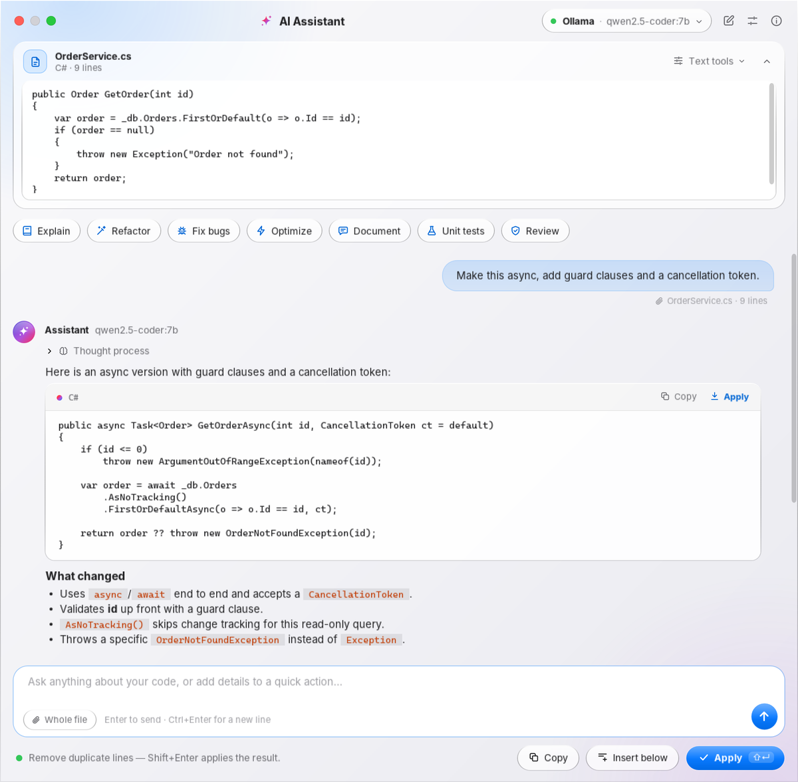
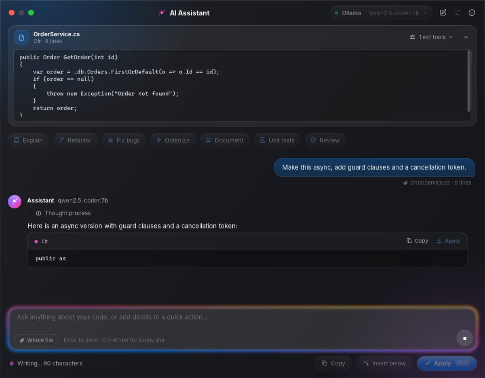
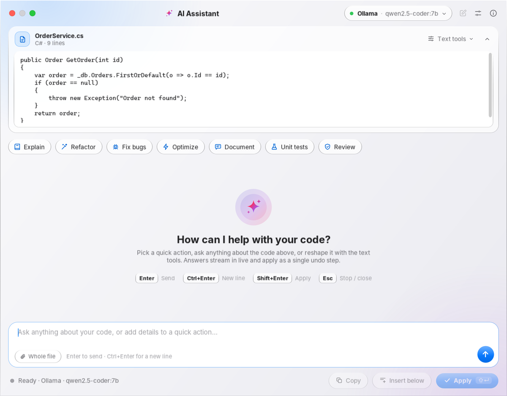
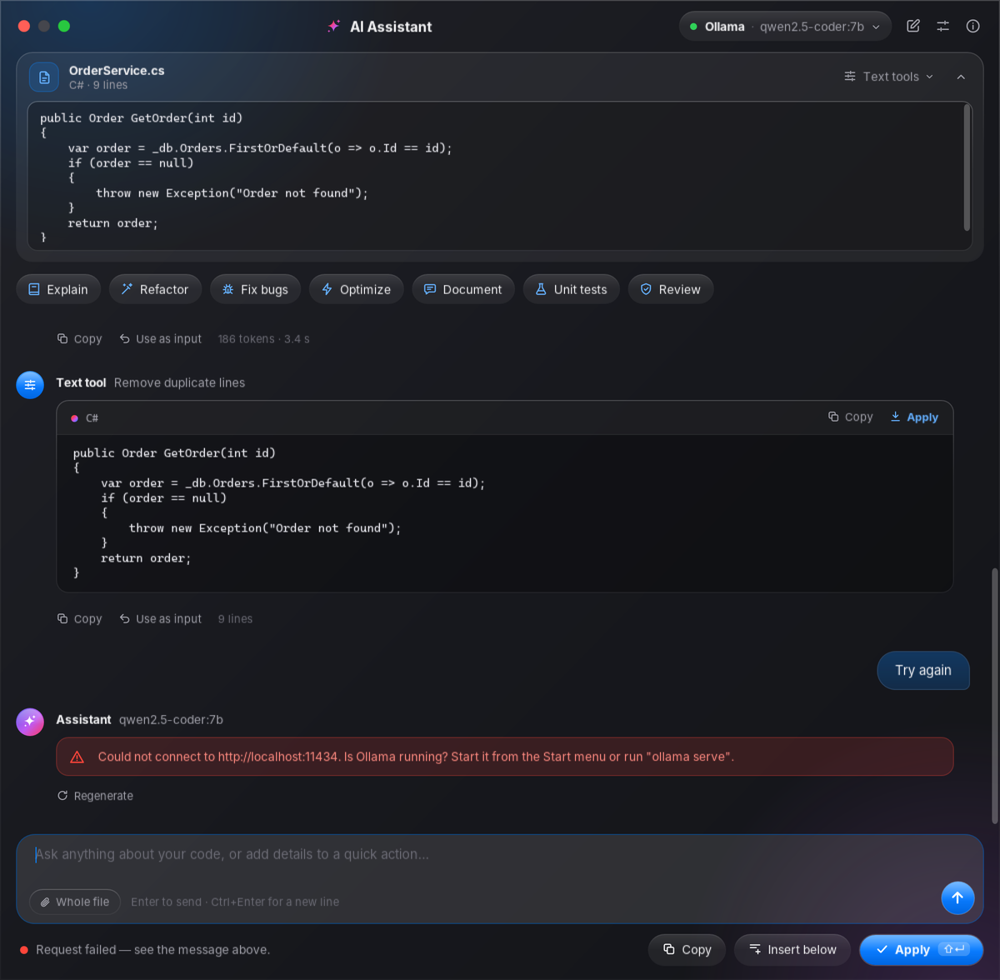
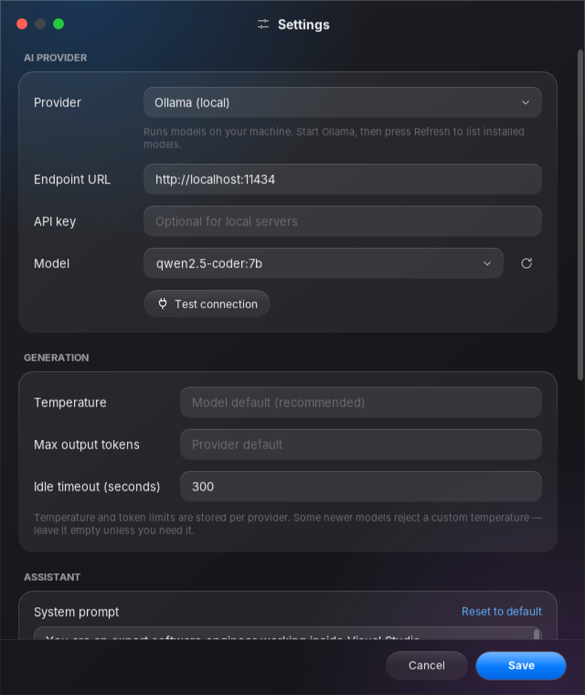

<div align="center">


# Local LLM Plugin — AI Assistant for Visual Studio

**A fast, private, beautifully designed AI coding assistant that lives inside Visual Studio.**
Run models locally with **Ollama** or **LM Studio**, or use **OpenAI**, **Anthropic** and **Google Gemini** — with streaming answers,
one-click quick actions and a single-step undoable apply, all in a macOS-inspired *Liquid Glass* interface.


[](https://marketplace.visualstudio.com/items?itemName=VisualStudioLocalLLMPlugin-WithOllama-ExtraTool.VisualStudioLocalLLMPlugin-WithOllama-ExtraTool)
[](https://github.com/furkiak/visualStudioLocalLLMPlugin/releases/latest)
[](https://github.com/furkiak/visualStudioLocalLLMPlugin/actions/workflows/build.yml)


[English](#english) · [Türkçe](#turkce)

<br>

<picture>
  <source media="(prefers-color-scheme: dark)" srcset="docs/images/assistant-dark.png">
  
</picture>

</div>

---

<a name="english"></a>

## ✨ What's new in 4.0

Version 4.0 is a ground-up refresh of the extension: new interface, new engine, new features — and a long list of fixes.

- **Liquid Glass redesign** — translucent glass surfaces, capsule buttons, Apple system colors, macOS traffic lights, a soft aurora backdrop and an animated *intelligence glow* while the model is writing. Dark and light themes that **follow your Visual Studio theme**, plus real **Windows 11 acrylic** blur behind the window.
- **Live streaming** for every provider — answers appear token by token, and **Esc** stops them instantly.
- **Conversations** — ask follow-up questions ("make it shorter", "now add tests"); the context is kept, and **Regenerate** gives you another take.
- **Quick actions** — Explain, Refactor, Fix bugs, Optimize, Document, Unit tests and Review in one click. Type extra instructions first to refine any of them.
- **Answers that read well** — Markdown rendering (headings, lists, bold, `inline code`) and code cards with **Copy** and **Apply** buttons.
- **Smarter apply** — only the code is inserted (no chatty text), indentation is matched to where it lands, the file's line endings are kept, and the whole change is **one Ctrl+Z**.
- **Insert below** in addition to *replace selection*, and **partial apply**: highlight part of an answer and press Shift+Enter.
- **Reasoning models** — the *Thought process* of DeepSeek-R1, Qwen3, gpt-oss and other thinking models is shown separately from the answer instead of polluting it.
- **LM Studio and any OpenAI-compatible server** (llama.cpp, vLLM, Jan, LocalAI…) as a first-class local provider.
- **Model picker** — press ↻ in Settings to list the models installed in Ollama or available to your API key, and **Test connection** to check everything at once.
- **Secure by default** — API keys are encrypted with Windows **DPAPI**, stored **per provider**, and the Gemini key is sent in a header instead of the URL.
- **More text tools** — Sort, Reverse, Remove empty lines, Trim trailing whitespace, UPPERCASE / lowercase join Remove duplicates, Modify & replicate, Erase and Add.
- **Visual Studio 2026 and Arm64** support, an editor right-click menu entry, and a crisp vector icon in menus.

<details>
<summary><b>Bugs fixed since 3.x</b></summary>

- Visual Studio could crash when a request failed (an exception escaped an `async void` command); the busy state could also get stuck.
- Pressing Shift+Enter while the model was still thinking inserted the text *"AI Thinking…"* — or an *"Error: …"* message — into your code.
- Requests to local models failed after 100 seconds; long generations are no longer cut off (an idle timeout is used instead, configurable).
- The OpenAI and Anthropic providers ignored any URL containing `localhost`, so local OpenAI-compatible servers could not be used.
- Text tools dropped the final line break of a full-line selection, gluing the next line onto the result. *Remove duplicates* also deleted every blank line.
- Enter sent the prompt even while typing in the code box; Ctrl+Enter did not add a new line as documented.
- Switching providers in Settings carried the previous provider's API key over to the new one.
- A corrupt `settings.json` broke the extension; it is now backed up and defaults are used.
- Retired default models of 3.x (Gemini 1.5 Pro and the old Anthropic default) are replaced automatically when old settings are migrated.
- Applying to a non-text document (e.g. a designer) crashed; it now falls back to the clipboard. Dialogs are properly owned by Visual Studio and never hide behind it.

</details>

## 📸 Screenshots

<table>
  <tr>
    <td width="50%"><br><sub><b>Streaming</b> — the composer glows while the model writes; Esc stops it.</sub></td>
    <td width="50%"><br><sub><b>Light theme</b> — follows your Visual Studio theme automatically.</sub></td>
  </tr>
  <tr>
    <td width="50%"><br><sub><b>Text tools &amp; clear errors</b> — every error says what to do next.</sub></td>
    <td width="50%"><br><sub><b>Settings</b> — per-provider profiles, model list, connection test.</sub></td>
  </tr>
</table>

## 🚀 Features

### AI assistant
| | |
|---|---|
| **Streaming chat** | Answers stream live from every provider. Follow-up questions keep the conversation; *New chat* (Ctrl+N) starts over. |
| **Quick actions** | Explain · Refactor · Fix bugs · Optimize · Document · Unit tests · Review. Add details in the prompt box to steer them. |
| **Code context** | The current selection, file name and language are sent automatically. Edit the code in the context box, or enable **Whole file** to give the model the entire document. |
| **Thought process** | Reasoning from thinking models is shown in a collapsible section, separate from the answer. |
| **Regenerate & Use as input** | Ask again for a different answer, or move a result into the code context to keep transforming it. |
| **Status & stats** | Live progress, token count and timing for every answer. |

### Applying results
| | |
|---|---|
| **Apply** (Shift+Enter) | Replaces the selection with the code from the latest answer — prose and Markdown fences are stripped. |
| **Insert below** (Ctrl+Shift+Enter) | Inserts the result under the selection, perfect for tests and documentation. |
| **Partial apply** | Highlight any part of an answer before applying to insert only that part. |
| **Per-block apply** | Every code card has its own Copy and Apply buttons. |
| **Indentation & line endings** | The result is re-indented to fit where it is inserted and uses the document's line endings. |
| **One undo step** | The edit goes through the Visual Studio editor API as a single transaction — Ctrl+Z restores everything. |

### Text tools (no AI needed)
Remove duplicate lines · Modify & replicate · Erase text · Add to every line · Sort A→Z / Z→A · Reverse lines · Remove empty lines · Trim trailing whitespace · UPPERCASE · lowercase.
Every tool keeps your line endings and the trailing line break, and its result can be applied, copied or chained into the next tool.

## 🔌 Supported providers

| Provider | Runs | API key | Notes |
|---|---|---|---|
| **Ollama** | Locally | – | Default. Lists your installed models; shows the thinking of reasoning models. |
| **LM Studio / OpenAI-compatible** | Locally | Optional | LM Studio, llama.cpp server, vLLM, Jan, LocalAI and any server with the OpenAI Chat Completions API. |
| **OpenAI** | Cloud | Required | Chat Completions with streaming. |
| **Anthropic** | Cloud | Required | Messages API with streaming. |
| **Google Gemini** | Cloud | Required | `streamGenerateContent`; the key is sent in the `x-goog-api-key` header. |

Each provider keeps its own URL, model, API key, temperature and token limit, so you can switch between them freely.
Default endpoints and models are pre-filled — press **↻** next to *Model* to pick from what your server or account actually offers.

## 📦 Installation

**From the Visual Studio Marketplace (recommended)** — in Visual Studio open **Extensions ▸ Manage Extensions**, search for **Local LLM Plugin** and click *Install*, or get it from the [Marketplace page](https://marketplace.visualstudio.com/items?itemName=VisualStudioLocalLLMPlugin-WithOllama-ExtraTool.VisualStudioLocalLLMPlugin-WithOllama-ExtraTool). Updates are delivered automatically.

**From GitHub Releases** — download `LocalLLMPlugin-v4.x.x.vsix` from the [latest release](https://github.com/furkiak/visualStudioLocalLLMPlugin/releases/latest) and double-click it.

Supported: Visual Studio 2022 17.0 or later and **Visual Studio 2026** (Community, Professional, Enterprise) on x64 or Arm64. Restart Visual Studio after installing, then open the assistant with **Ctrl+1**, from **Tools ▸ AI Assistant (Local LLM)**, or by right-clicking in the code editor.

Upgrading from 3.x? Your settings and API key are migrated automatically. See the [changelog](CHANGELOG.md) for everything that changed.

### Quick start with a local model (Ollama)

```bash
# 1. Install Ollama from https://ollama.com, then download a coding model:
ollama pull qwen2.5-coder:7b

# 2. Make sure it is running (it usually starts automatically):
ollama serve
```

Select some code in Visual Studio, press **Ctrl+1**, pick a quick action — done. Nothing leaves your machine.

### Using a cloud provider

Open **Settings** (Ctrl+, or the sliders icon), choose the provider, paste your API key, press **↻** to load the models, then **Test connection** and **Save**.

## ⌨️ Keyboard shortcuts

| Shortcut | Action |
|---|---|
| `Ctrl+1` | Open the assistant (global Visual Studio shortcut) |
| `Enter` | Send the prompt |
| `Ctrl+Enter` | New line in the prompt |
| `Shift+Enter` | Apply the result to the editor (replace selection) |
| `Ctrl+Shift+Enter` | Insert the result below the selection |
| `Esc` | Stop the answer while it is streaming · close the window otherwise |
| `Ctrl+N` | New chat |
| `Ctrl+,` | Settings |

## ⚙️ Settings

| Setting | Description |
|---|---|
| Provider, Endpoint URL, API key, Model | Stored per provider. Leave the URL empty for the default endpoint. Full endpoints such as `…/api/generate` or `…/chat/completions` are accepted too. |
| Temperature, Max output tokens | Optional; empty means the model's default (recommended — some newer models reject custom values). |
| Idle timeout | How long to wait **without receiving data** before giving up (default 300 s). Long answers are never cut off. |
| System prompt | Instructions sent with every request. *Reset to default* restores the built-in prompt. |
| Whole file by default | Sends the full document as context (up to 120,000 characters). |
| Match indentation | Re-indents applied code to fit the insertion point. |
| Show thought process | Displays reasoning from thinking models. |
| Theme | *Auto* follows Visual Studio; or force Dark / Light. |
| Translucent glass | Windows 11 acrylic backdrop (22H2 or later). |

Settings live in `%AppData%\LLLMPluginModern\settings.json`. API keys are encrypted with DPAPI for your Windows user account. Settings from version 3.x are migrated automatically the first time 4.0 starts.

## 🏗️ Architecture

```
LLLMPluginModern/
├── Core/              Pure .NET, no WPF or Visual Studio dependencies
│   ├── Interfaces/    ILlmApiService, ISettingsService, IEditorService, IDialogService …
│   ├── Models/        AppSettings (per-provider profiles), LlmRequest/Response, EditorContext
│   ├── Prompts/       System prompt, quick actions, message building
│   └── Text/          Text tools, Markdown reader, <think> filter, language map
├── Infrastructure/
│   ├── Http/          Shared HttpClient (proxy-aware, loopback bypass), endpoint normalization
│   ├── Services/      LlmApiServiceBase + Ollama / OpenAI / Anthropic / Gemini streaming clients, SettingsService (DPAPI)
│   └── Factories/     Provider → service
├── UI/
│   ├── Themes/        Dark.xaml, Light.xaml, Icons.xaml (vector icons), Controls.xaml (Liquid Glass styles)
│   ├── Controls/      GlassWindow (custom chrome, Win11 acrylic), TrafficLights, Icon
│   ├── ViewModels/    MVVM: chat, settings and dialogs; async commands
│   └── Views/         Assistant window, settings and dialogs
├── VisualStudio/      Command, editor integration (ITextBuffer edits, undo transaction), dialog owner, theme detection
└── AppServices.cs     Composition root
tests/LLLMPluginModern.Tests/   xUnit tests for Core, endpoint handling and the settings service
```

Design decisions:

- **Streaming pipeline** — one base class handles sending, user cancellation, idle timeouts, HTTP/JSON error extraction and friendly connection messages; each provider only parses its own stream format. UI updates are batched (about 20 per second) so even very fast local models keep the window smooth.
- **Modern editor API** — edits use `ITextBuffer` with an undo transaction instead of DTE `TextSelection`, so they are atomic, fast, and free of auto-format side effects.
- **No dependency conflicts in `devenv.exe`** — the package contains only the extension itself; `Newtonsoft.Json` comes from Visual Studio. The DI container and polyfill packages of 3.x were replaced by a small composition root.
- **Theme-aware resources** — every color is a `DynamicResource`, so switching Dark/Light re-skins open windows instantly.

## 🛠️ Building from source

Requirements: Visual Studio 2022 (17.x) or Visual Studio 2026 with the **Visual Studio extension development** workload.

1. Open `LLLMPluginModern.sln`.
2. Build — NuGet packages restore automatically.
3. Press **F5** to start an experimental instance of Visual Studio with the extension loaded.

The `.vsix` is written to `LLLMPluginModern/bin/<Configuration>/`. From the command line: `msbuild LLLMPluginModern.sln -restore -p:Configuration=Release`.

**Tests** — `dotnet test tests/LLLMPluginModern.Tests` runs 81 tests for the Markdown reader, the `<think>` filter, the text tools, prompt building, endpoint normalization and the settings service (DPAPI round trip, 3.x migration, corrupt files). They compile the extension's source files directly, so they need neither the Visual Studio SDK nor a Visual Studio instance; CI runs them before anything is released.

### Releasing

Every push is built on Windows by [GitHub Actions](.github/workflows/build.yml) and the `.vsix` is attached to the run as an artifact.
Pushing a tag such as `v4.0.0` (it must match the version in `source.extension.vsixmanifest`) also:

1. creates a GitHub release with the `.vsix` and the notes from `docs/release-notes/<tag>.md`;
2. publishes to the Visual Studio Marketplace using [`marketplace/publishManifest.json`](marketplace/publishManifest.json) and [`marketplace/overview.md`](marketplace/overview.md) — when the repository secret `VS_MARKETPLACE_TOKEN` (an Azure DevOps personal access token with the *Marketplace ▸ Manage* scope) is set.

Without a local tag: open **Actions ▸ Build & Release ▸ Run workflow** on `master` and tick *Create the release*; the commit is tagged `v<manifest version>` and the same steps run.

## 🩺 Troubleshooting

| Message | What to do |
|---|---|
| *Could not connect to http://localhost:11434* | Start Ollama (`ollama serve`) or LM Studio's server, and check the URL in Settings. |
| *Ollama: model "…" not found* | Run `ollama pull <model>` or pick an installed model with ↻. |
| *… returned 401 / 403* | Check the API key for that provider in Settings. |
| *… returned 404* | Check the endpoint URL and the model name. |
| *No data from … for N seconds* | A large model may still be loading — try again or raise the idle timeout. |
| Behind a corporate proxy | Cloud requests use the Windows proxy settings; local addresses always bypass the proxy. |

## 🤝 Contributing

Pull requests are welcome. For larger changes, please open an issue first to discuss what you would like to change.

## 📄 License

[GNU Affero General Public License v3.0](LICENSE.txt) — © Furkan Akça · Spaceandtab

---

<a name="turkce"></a>

## 🇹🇷 Türkçe

### Local LLM Plugin — Visual Studio için Yapay Zekâ Asistanı

**Visual Studio'nun içinde çalışan; hızlı, gizliliğe saygılı ve şık tasarımlı bir yapay zekâ kodlama asistanı.**
Modelleri **Ollama** veya **LM Studio** ile tamamen yerelde çalıştırın ya da **OpenAI**, **Anthropic** ve **Google Gemini** kullanın.
Akış hâlinde gelen yanıtlar, tek tıkla hızlı eylemler ve tek adımda geri alınabilen uygulama — hepsi macOS'tan ilham alan *Liquid Glass* arayüzünde.

### ✨ 4.0 ile gelen yenilikler

- **Liquid Glass tasarım** — yarı saydam cam yüzeyler, kapsül düğmeler, Apple sistem renkleri, macOS trafik ışıkları, yumuşak "aurora" arka plan ve model yazarken animasyonlu *zekâ parıltısı*. **Visual Studio temasını takip eden** koyu ve açık tema; Windows 11'de pencere arkasında gerçek **akrilik bulanıklık**.
- **Canlı akış (streaming)** — tüm sağlayıcılarda yanıt kelime kelime gelir; **Esc** ile anında durdurulur.
- **Sohbet** — devam soruları sorun ("daha kısa yap", "şimdi test ekle"); bağlam korunur. **Yeniden üret** ile farklı bir yanıt alın.
- **Hızlı eylemler** — Açıkla, Yeniden düzenle (Refactor), Hataları düzelt, Optimize et, Belgele, Birim testleri, Kod incelemesi. Ek talimatı önce yazarak eylemi yönlendirebilirsiniz.
- **Okunaklı yanıtlar** — Markdown görüntüleme (başlık, liste, kalın, `satır içi kod`) ve **Kopyala** / **Uygula** düğmeli kod kartları.
- **Akıllı uygulama** — editöre yalnızca kod eklenir (açıklama metni değil), girinti eklenen yere göre ayarlanır, dosyanın satır sonları korunur ve tüm değişiklik **tek Ctrl+Z** ile geri alınır.
- **Alta ekle** seçeneği ve **kısmi uygulama**: yanıtın bir bölümünü seçip Shift+Enter'a basın.
- **Akıl yürüten modeller** — DeepSeek-R1, Qwen3, gpt-oss gibi modellerin *düşünce süreci* yanıttan ayrı, katlanabilir bir bölümde gösterilir.
- **LM Studio ve tüm OpenAI uyumlu sunucular** (llama.cpp, vLLM, Jan, LocalAI…) birinci sınıf yerel sağlayıcı olarak desteklenir.
- **Model seçici** — Ayarlar'da ↻ ile Ollama'da kurulu ya da API anahtarınızla erişilebilen modelleri listeleyin; **Bağlantıyı test et** ile her şeyi tek seferde doğrulayın.
- **Güvenlik** — API anahtarları Windows **DPAPI** ile şifrelenir ve **sağlayıcı başına** ayrı saklanır; Gemini anahtarı URL yerine başlıkta gönderilir.
- **Daha fazla metin aracı** — Sırala, Ters çevir, Boş satırları sil, Satır sonu boşluklarını kırp, BÜYÜK / küçük harf; Tekrarları sil, Değiştir ve çoğalt, Sil ve Ekle araçlarına katıldı.
- **Visual Studio 2026 ve Arm64** desteği, editör sağ tık menüsü ve menülerde net bir vektör ikon.

<details>
<summary><b>3.x'e göre giderilen hatalar</b></summary>

- Bir istek başarısız olduğunda Visual Studio çökebiliyordu (`async void` komuttan istisna kaçıyordu); "meşgul" durumu takılı kalabiliyordu.
- Model hâlâ düşünürken Shift+Enter'a basmak koda *"AI Thinking…"* ya da *"Error: …"* metnini yazıyordu.
- Yerel modellere istekler 100 saniyede kesiliyordu; artık uzun yanıtlar kesilmiyor (bunun yerine ayarlanabilir bir boşta kalma süresi kullanılıyor).
- OpenAI ve Anthropic sağlayıcıları `localhost` içeren adresleri yok sayıyordu; yerel OpenAI uyumlu sunucular kullanılamıyordu.
- Metin araçları tam satır seçimlerinde son satır sonunu siliyor, sonraki satırı sonuca yapıştırıyordu. *Tekrarları sil* tüm boş satırları da siliyordu.
- Enter, kod kutusuna yazarken bile istemi gönderiyordu; Ctrl+Enter belgelendiği gibi yeni satır eklemiyordu.
- Ayarlar'da sağlayıcı değiştirmek önceki sağlayıcının API anahtarını yenisine taşıyordu.
- Bozuk bir `settings.json` eklentiyi bozuyordu; artık yedeklenip varsayılanlar kullanılıyor.
- 3.x'in emekliye ayrılan varsayılan modelleri (Gemini 1.5 Pro ve eski Anthropic varsayılanı) eski ayarlar taşınırken otomatik olarak güncelleniyor.
- Metin olmayan bir belgeye (ör. tasarımcı) uygulamak çöküyordu; artık sonuç panoya kopyalanıyor. Pencereler Visual Studio'ya doğru şekilde bağlı; arkada kalmıyor.

</details>

### 🔌 Desteklenen sağlayıcılar

| Sağlayıcı | Çalışma | API anahtarı | Not |
|---|---|---|---|
| **Ollama** | Yerel | – | Varsayılan. Kurulu modelleri listeler; akıl yürüten modellerin düşüncelerini gösterir. |
| **LM Studio / OpenAI uyumlu** | Yerel | İsteğe bağlı | LM Studio, llama.cpp, vLLM, Jan, LocalAI ve OpenAI Chat Completions API'si sunan her sunucu. |
| **OpenAI** | Bulut | Gerekli | Akışlı Chat Completions. |
| **Anthropic** | Bulut | Gerekli | Akışlı Messages API. |
| **Google Gemini** | Bulut | Gerekli | `streamGenerateContent`; anahtar `x-goog-api-key` başlığında gönderilir. |

Her sağlayıcının URL'si, modeli, API anahtarı, sıcaklığı ve token sınırı ayrı saklanır; aralarında özgürce geçiş yapabilirsiniz.

### 📦 Kurulum

**Visual Studio Marketplace'ten (önerilir)** — Visual Studio'da **Extensions ▸ Manage Extensions** menüsünü açın, **Local LLM Plugin** aratıp *Install*'a tıklayın ya da [Marketplace sayfasından](https://marketplace.visualstudio.com/items?itemName=VisualStudioLocalLLMPlugin-WithOllama-ExtraTool.VisualStudioLocalLLMPlugin-WithOllama-ExtraTool) indirin. Güncellemeler otomatik gelir.

**GitHub Releases'tan** — [son sürümdeki](https://github.com/furkiak/visualStudioLocalLLMPlugin/releases/latest) `LocalLLMPlugin-v4.x.x.vsix` dosyasını indirip çift tıklayın.

Desteklenenler: Visual Studio 2022 17.0 ve üzeri ile **Visual Studio 2026** (Community, Professional, Enterprise), x64 veya Arm64. Kurulumdan sonra Visual Studio'yu yeniden başlatın; asistanı **Ctrl+1** ile, **Tools ▸ AI Assistant (Local LLM)** menüsünden ya da kod editöründe sağ tıklayarak açın.

3.x'ten mi geçiyorsunuz? Ayarlarınız ve API anahtarınız otomatik taşınır. Tüm değişiklikler için [değişiklik günlüğüne](CHANGELOG.md) bakın.

**Yerel modelle hızlı başlangıç (Ollama):**

```bash
# 1. https://ollama.com adresinden Ollama'yı kurun ve bir kod modeli indirin:
ollama pull qwen2.5-coder:7b

# 2. Çalıştığından emin olun (genellikle otomatik başlar):
ollama serve
```

Visual Studio'da kod seçin, **Ctrl+1**'e basın, bir hızlı eylem seçin — bu kadar. Hiçbir veri bilgisayarınızdan çıkmaz.

**Bulut sağlayıcı kullanmak için:** **Ayarlar**'ı açın (Ctrl+, veya kaydırıcı simgesi), sağlayıcıyı seçin, API anahtarınızı yapıştırın, **↻** ile modelleri yükleyin, **Bağlantıyı test et** ve **Kaydet**.

### ⌨️ Klavye kısayolları

| Kısayol | İşlev |
|---|---|
| `Ctrl+1` | Asistanı açar (global Visual Studio kısayolu) |
| `Enter` | İstemi gönderir |
| `Ctrl+Enter` | İstem kutusunda yeni satır |
| `Shift+Enter` | Sonucu editöre uygular (seçimi değiştirir) |
| `Ctrl+Shift+Enter` | Sonucu seçimin altına ekler |
| `Esc` | Akış sürerken yanıtı durdurur, aksi hâlde pencereyi kapatır |
| `Ctrl+N` | Yeni sohbet |
| `Ctrl+,` | Ayarlar |

### ⚙️ Ayarlar

- **Sağlayıcı, Uç nokta URL'si, API anahtarı, Model** — sağlayıcı başına saklanır. Varsayılan uç nokta için URL'yi boş bırakın; `…/api/generate` veya `…/chat/completions` gibi tam adresler de kabul edilir.
- **Sıcaklık, Maksimum çıktı tokenı** — isteğe bağlıdır; boş bırakmak modelin varsayılanını kullanır (önerilir).
- **Boşta kalma süresi** — veri gelmeden ne kadar bekleneceği (varsayılan 300 sn). Uzun yanıtlar asla kesilmez.
- **Sistem istemi** — her istekle gönderilen talimatlar; *Varsayılana dön* ile sıfırlanır.
- **Varsayılan olarak tüm dosya**, **Girintiyi eşleştir**, **Düşünce sürecini göster**, **Tema** (Otomatik / Koyu / Açık), **Saydam cam** (Windows 11).

Ayarlar `%AppData%\LLLMPluginModern\settings.json` dosyasındadır. API anahtarları Windows kullanıcı hesabınız için DPAPI ile şifrelenir. 3.x ayarları, 4.0 ilk açıldığında otomatik olarak taşınır.

### 🏗️ Mimari

- **Core** — WPF ve Visual Studio bağımlılığı olmayan saf .NET katmanı: arayüzler, modeller, istem oluşturma, metin araçları, Markdown okuyucu.
- **Infrastructure** — paylaşılan HttpClient, akış tabanlı sağlayıcı istemcileri (Ollama / OpenAI / Anthropic / Gemini) ve DPAPI ile şifreli ayar servisi.
- **UI** — MVVM; Liquid Glass tema sözlükleri, özel cam pencere (Windows 11 akrilik), vektör ikonlar, sohbet, ayarlar ve diyaloglar.
- **VisualStudio** — komut, modern editör API'siyle (ITextBuffer + geri alma işlemi) düzenleme, diyalog sahipliği ve tema algılama.
- `devenv.exe` içinde bağımlılık çakışması yok: paket yalnızca eklentinin kendisini içerir; `Newtonsoft.Json` Visual Studio'dan gelir.

### 🛠️ Kaynaktan derleme

Gereksinim: **Visual Studio extension development** iş yüküyle Visual Studio 2022 (17.x) veya Visual Studio 2026.
`LLLMPluginModern.sln` dosyasını açın, derleyin ve eklentinin yüklü olduğu deneysel Visual Studio örneğini başlatmak için **F5**'e basın.

**Testler** — `dotnet test tests/LLLMPluginModern.Tests` Markdown okuyucu, `<think>` filtresi, metin araçları, istem oluşturma, uç nokta düzeltme ve ayar servisi (DPAPI, 3.x aktarımı, bozuk dosya) için 81 testi çalıştırır. Testler eklentinin kaynak dosyalarını doğrudan derler; Visual Studio SDK'sı ya da Visual Studio gerekmez. CI, bir sürüm yayımlanmadan önce bunları çalıştırır.

### 🩺 Sorun giderme

| Mesaj | Çözüm |
|---|---|
| *Could not connect to http://localhost:11434* | Ollama'yı (`ollama serve`) veya LM Studio sunucusunu başlatın, Ayarlar'daki URL'yi kontrol edin. |
| *Ollama: model "…" not found* | `ollama pull <model>` çalıştırın veya ↻ ile kurulu bir model seçin. |
| *… returned 401 / 403* | O sağlayıcının API anahtarını kontrol edin. |
| *… returned 404* | Uç nokta URL'sini ve model adını kontrol edin. |
| *No data from … for N seconds* | Büyük bir model hâlâ yükleniyor olabilir; tekrar deneyin veya bekleme süresini artırın. |

### 🤝 Katkıda bulunma

Pull Request'ler memnuniyetle karşılanır. Büyük değişiklikler için lütfen önce bir konu (issue) açarak neyi değiştirmek istediğinizi tartışın.

### 📄 Lisans

[GNU Affero General Public License v3.0](LICENSE.txt) — © Furkan Akça · Spaceandtab
