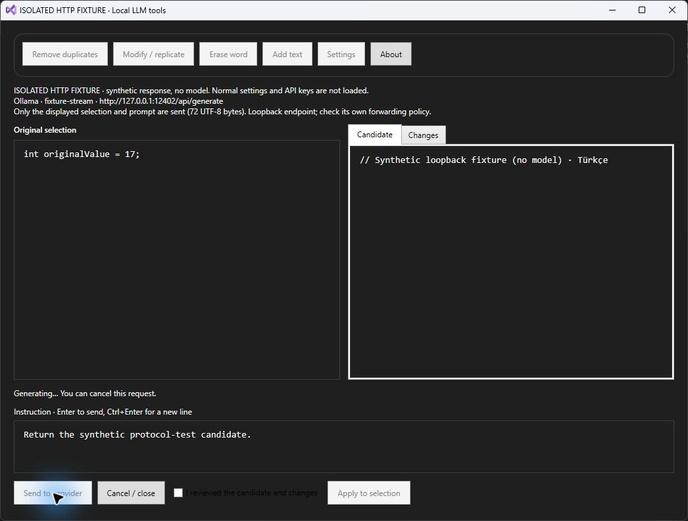
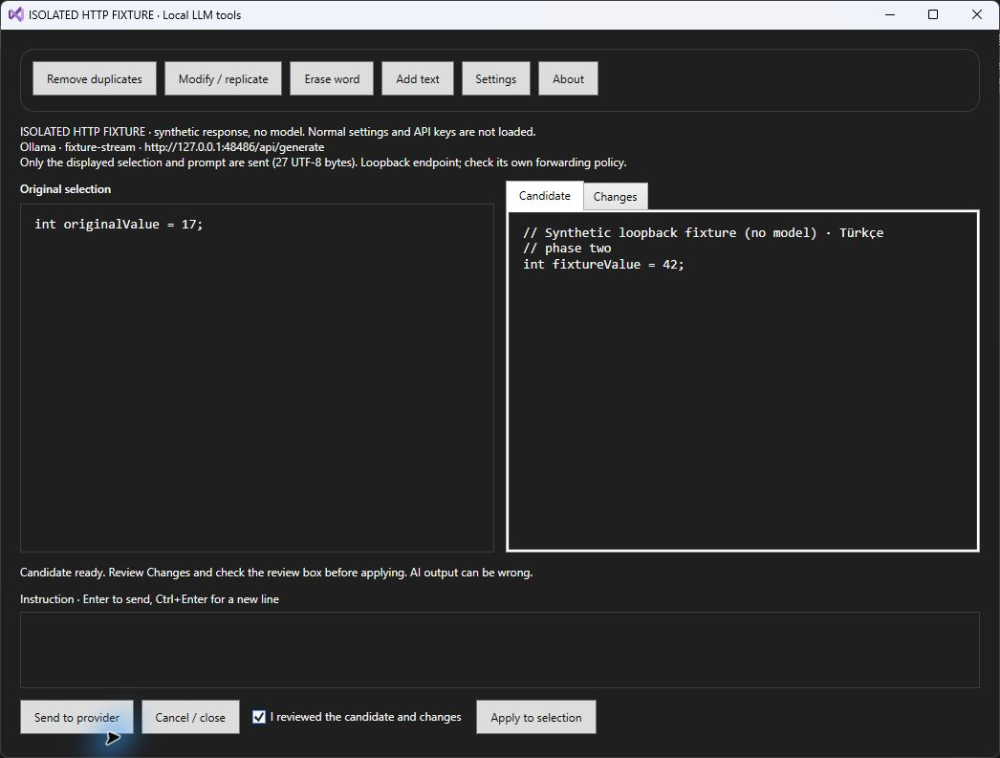

# Release candidate validation

## Current appearance candidate 3.1.3 · 27 September 2026

The local suite passes **83/83, zero skipped**, retaining all previous 62 cases. New tests use owned temporary files and synthetic DPAPI keys for legacy 100% defaults, font/secret roundtrips, malformed/unsupported/duplicate preferences, atomic replacement failure, isolated credential-free profiles and view-model font reload without changing the reviewed candidate, original selection or request disclosure. A changed-provider/font reload binding test uses an explicitly named adapter stub; it is not model or network evidence. Existing protocol tests still exercise production providers over ephemeral loopback TCP HTTP.

Removing the normal settings font guard produces three expected failures; suppressing MainViewModel font reload produces two. Restored production source passes all 83 again. Release VSIX compilation succeeds. The new UI uses dynamic VS host resources and explicit templates instead of hardcoded dark entry/combobox colors. See [appearance and remaining native steps](APPEARANCE.md).

**No native IDE or standalone fixture was started for this appearance change.** Native 3.1.3 popup/template usability, keyboard/focus, 200% layout and actual color contrast are pending. The following dated 3.1.0–3.1.2 native records and screenshots describe earlier layouts; they do not close these new appearance checks. No actual model/provider account, normal settings or OS display/theme preference was used or changed.

## Earlier verification records

2026-09-22 · Windows x64 · VS Professional 2022 17.14 MSBuild · SDK 10.0.401 · .NET Framework 4.8 runtime executing net472 tests.

| Check | Result |
| --- | --- |
| Windows DPAPI encrypt/decrypt, legacy migration, no plaintext backup, tamper rejection, failed atomic replace | Passed using synthetic keys and temporary directories |
| Apply gating, stale selection snapshot, errors, cancellation, busy reset, duplicate send, late response on close | Passed on production view-model/model source |
| Four provider HTTP contracts, 401/403/404/429/500, invalid JSON, incomplete output, timeout, endpoint validation | Passed with HTTP fixtures; no external model calls |
| Real loopback chunked HTTP: first NDJSON piece before final piece; cancel after headers/body begins | Passed with a local TCP HTTP fixture |
| Release VSIX build | Passed; no warning in final local build |
| Real Visual Studio selection → review → apply → one Undo | Passed 2026-09-23 in Professional 2022 17.14 with a disposable C# file and the local Remove duplicates action. Initially Apply stayed disabled after review because the command compared COM document wrappers by reference; after comparing the active document path, the button enabled, the duplicate line was removed, and one editor Undo restored the original buffer. No provider call was made. |
| Different Windows account cannot decrypt the DPAPI blob | Pending actual second-account check; tamper tests are not a substitute |
| Community / Enterprise runtime and fresh-machine VSIX install | Pending; manifest targeting is not a runtime test |
| Real Ollama, OpenAI, Gemini, Anthropic model responses | Pending; no credentials or proprietary code used in tests |

The framework HTTP stack can buffer fixed Content-Length responses until more body data arrives. Incremental behavior is verified for chunked NDJSON, the intended Ollama streaming transport. Reverse proxies must forward chunks rather than buffer them. No token streaming is claimed for the other three providers.

The tested Visual Studio instance used `/RootSuffix CodexLLLM`. The extension showed version 3.1.0 in Extension Manager. Its originally advertised Ctrl+1 binding was intercepted as the first key of an IDE chord, so this candidate now uses the Tools menu without a default binding. The real IDE check covers the local review/apply/Undo path only; it does not validate remote providers, DPAPI under another Windows account, or another Visual Studio SKU.

## IDE smoke procedure

27 September 2026 update: the isolated validation profile and external [HTTP fixture](HTTP_FIXTURE.md) support a native repeatable provider-protocol check without personal settings. The local suite passes 62 cases (all previous 47 retained), including production factory/provider/view-model over actual chunked TCP HTTP for streaming, 401, malformed NDJSON, body timeout/cancel and recovery. The expected-red `ResponseContentRead` mutation blocks the first Candidate update before completion; source restoration makes the suite pass.

### Actual IDE protocol check, 27 September 2026

The clean `80a8e41` VSIX (3.1.1, SHA-256 `80FA248FC840FF0EDD80776674D03612206C43F6012826AAE37D3D9C16FF0C21`) was installed into Professional 2022 17.14 `/RootSuffix CodexLLLM`. The installed DLL matched the clean build byte for byte. After installation, `/UpdateConfiguration` refreshed the experimental instance's Tools command registration. Only this instance inherited the explicit fixture profile.

| Actual native action | Observed result |
| --- | --- |
| Send the disposable C# selection to `fixture-stream` | The UTF-8 first line appeared in Candidate while `Generating` and Apply stayed disabled. The final phase appeared later. |
| Change scenario through Settings to `fixture-401` | Authentication status; Candidate empty; Send re-enabled; Apply disabled. |
| Send to `fixture-malformed` | First line visible while busy, then invalid JSON status and an empty Candidate. |
| Send to `fixture-timeout` | First line visible; about 15 seconds later timeout status, empty Candidate and re-enabled Send. |
| Send to `fixture-cancel`, then press Cancel | Request cancelled status, empty Candidate and no editor mutation. |
| Switch back to `fixture-stream` without restarting | Successful final Candidate in the same window; Changes showed the replacement against `int originalValue = 17;`. |
| Check review and Apply to this test selection | Apply became enabled only after review. The editor received the synthetic three-line candidate; one native Undo restored the original clean buffer. |

The fixture event log recorded 72 prompt bytes, scenario/stage/timestamps, and actual connection termination for timeout/cancel; it did not log content or credentials. The fixture exited after its owned stop file. No actual Ollama or cloud model was called. This proves the native protocol/review path, not model quality or production performance. The check did not cover native corrupt-settings recovery, stale-selection mutation, another Windows account/SKU, a fresh machine or full accessibility scaling.

The native dark-theme check also exposed a black review-checkbox label. Version 3.1.2 explicitly binds that label to the Visual Studio text brush; it changes appearance only. A clean `e869101` build passed the same 62 tests with zero skips and produced a warning-free VSIX. Its installed DLL matched the clean build (SHA-256 `73A2989C4AF141222C8361058A1BE31CC98A54679A4CBB5E8D8F1A8EF1A408D7`). In the same dedicated Professional experimental instance, the new label was readable before and after a synthetic request; Apply remained disabled until the review box was checked. This appearance recheck did not repeat the full 3.1.1 error matrix above or call a model.

Use a dedicated experimental VS instance and a disposable text file containing two identical lines. Do not use a production solution.

1. Select both lines; open Tools → Local LLM Plugin (Modern). Apply must be disabled initially.
2. Choose Remove duplicates. Original must retain both lines, Candidate one line, Changes show a removal. Apply remains disabled until review is checked.
3. Check the review box; apply. Only the original selection changes. Ctrl+Z restores both lines in one operation.
4. Generate with the local fixture or a configured model. Cancel while waiting: no editor change; busy clears; Apply is disabled. Close while waiting: the HTTP operation is cancelled.
5. Cause a 401, malformed stream and timeout. Error text stays in status; Apply cannot replace code with it. Recover through Settings without restarting VS.
6. Change target contents/selection while a request is pending using a second editor surface. Applying a stale result must be rejected.
7. Check light/dark/high-contrast themes, keyboard-only controls, 200% scaling and a narrow window. Record actual screenshots and VS build number.

## Migration and rollback

The first successful settings read replaces the legacy `ApiKey` field with a DPAPI-protected `ProtectedApiKey` field, preserving provider, model and URL. Failed parsing/decryption leaves the existing file untouched. Settings shows a recovery explanation; saving explicitly replaces unreadable settings. The extension does not inspect or modify old backups.

Version 3.0 cannot read the protected key format. A rollback to 3.0 requires re-entering the key and restores that version's plaintext-storage risk. Prefer disabling 3.1 while investigating instead of downgrading and re-saving secrets. Keep the old VSIX available, but do not change old release assets or tags.

## Sources

- [Windows DPAPI CurrentUser](https://learn.microsoft.com/en-us/dotnet/api/system.security.cryptography.protecteddata)
- [Ollama generation and streaming](https://docs.ollama.com/api/generate)
- [VSIX target SKU inheritance](https://learn.microsoft.com/en-us/visualstudio/extensibility/vsix-extension-schema-2-0-reference?view=vs-2022)
